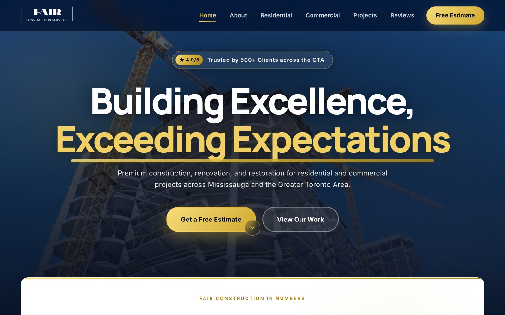

<div align="center">

# 🏗️ Fair Construction Services

A premium website for a renovation and restoration company in Mississauga, showcasing residential and commercial projects.

<a href="https://fairconstruction-ca.vercel.app/"></a>
<a href="https://github.com/miladmo68/fairconstruction.ca"></a>
<a href="https://miladweb.com"></a>

**🔗 Live:** [fairconstruction-ca.vercel.app](https://fairconstruction-ca.vercel.app/)

</div>

<p align="center">
  
</p>

## ✨ Features

- Residential and commercial service pages
- Project gallery and trust highlights
- Free-estimate call to action
- Responsive, fast static site

## 🛠️ Tech Stack

   

## 🚀 Getting Started

**Run locally**

```bash
git clone https://github.com/miladmo68/fairconstruction.ca.git
cd fairconstruction.ca
# open index.html in your browser, or serve the folder:
npx serve .
```

## 📁 Project Structure

```
fairconstruction.ca/
├── img/
├── theme/
├── index.html
├── main.js
└── styles.css
```

## 👤 Author

**Milad Mohammadi** — Frontend-Focused Full-Stack Developer, Toronto 🇨🇦

[](https://miladweb.com)
[](https://www.linkedin.com/in/miladmo68/)
[](https://github.com/miladmo68)

<p align="center"><sub>If you like this project, consider giving it a ⭐</sub></p>
